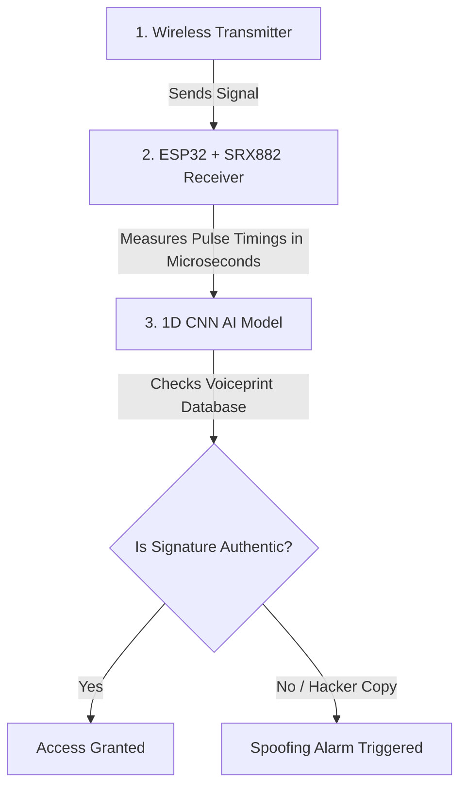

# RFPrint: Radio Frequency Device Fingerprinting & Security

Welcome to the **RFPrint** platform. This project is a physical-layer security system designed to identify and authenticate wireless transmitters (like key fobs or smart home sensors) based on their unique, microscopic hardware signatures.

---

## 1. The Core Idea (In Layman's Terms)

### 🗣️ The Vocal Cord Analogy
Think of this system as **voice recognition for electronic devices**. 

If two people say the exact same word—for example, "Hello"—your ears can easily tell who is speaking. Even though the word (the *data*) is identical, the physical shape of their vocal cords, throat, and mouth gives each person a unique vocal print (the *voiceprint*). 

Wireless devices work the same way. When two different key fobs send the exact same command (for example, "unlock car door"):
1. The **data** they transmit is identical (a sequence of 1s and 0s).
2. However, the **physical components** inside the key fobs (microscopic capacitors, copper antennas, silicon chips, and crystal oscillators) have tiny, microscopic manufacturing variations.
3. Because of these variations, one device might tick a tiny bit faster, discharge its capacitor a microsecond slower, or have slightly more electrical "jitter" than the other.

Our system uses **Artificial Intelligence (AI)** to listen to these sub-microsecond variations. By learning each device's electronic "voiceprint," we can tell them apart and block hackers from copying the signals.

---

## 2. The 3-Step Process (How It Works)



### Step 1: Signal Measurement (The Ear)
When a transmitter (like a key fob) is pressed, it broadcasts a radio wave. 
* Our cheap **SRX882 receiver module** (costing only ₹150) catches the wave and turns it into digital high/low electrical pulses.
* Our **ESP32 microcontroller** acts as a high-precision stopwatch, measuring the exact length of each pulse in **microseconds** (millionths of a second).

### Step 2: AI Signature Verification (The Brain)
The pulse measurements are fed into a **1D Convolutional Neural Network (CNN)**. 
* The AI looks at the sequence of pulse durations and extracts the device's clock drift and jitter fingerprint.
* It calculates the **Mahalanobis Distance** (a mathematical ruler) to measure how close this fingerprint is to the known device's average signature stored in memory.

### Step 3: Security Decision (The Guard)
* **Access Granted**: If the fingerprint matches the owner's key fob, access is allowed.
* **Access Denied**: If a hacker records the owner's code and replays it using a different transmitter, the code is correct, but the electronic "voiceprint" will be wrong. The system immediately rejects the signal and sounds a spoofing alarm.

---

## 3. What Does the Platform Output?

When running the system, you will see three main outputs:

1. **The Visual Dashboard (RFPrint HUD)**:
   * **FFT Spectrum Panel**: Shows a live line chart of the radio waves in the air.
   * **Waterfall Panel**: A scrolling heat map showing frequency histories over time.
   * **Vector Constellation**: Shows how clean the received signal pulses are.
   * **Inference Console**: Renders a live meter displaying the probability of which device is transmitting (e.g. `DEV_A: 98%`) and whether it is an intruder.
2. **Quantized TinyML Model**:
   * A tiny AI file (under 50 KB) that runs directly on the ESP32 chip itself. This allows the system to authenticate signals locally in **less than 2 milliseconds** without needing an internet connection or a computer.
3. **Security Alerts**:
   * If a spoofing attempt is detected, the system outputs an alert log containing the measured jitter levels and classification confidence to local monitoring dashboards.

---

## 4. How We "Take" Data (The Capture Phase)

Taking data is simply recording the microsecond-precision "fingerprints" of each transmitter.

```plaintext
  Transmitter Sends Wave     SRX882 Demodulates       ESP32 Measures Time     Serial Out to Laptop
  [Key Fob] -----------> [Receiver Pin HIGH/LOW] ---> [Timer: 502µs, 248µs] ---> [JSON Data Logs]
```

### Step 1: Microsecond Pulse Counting
When you press your 433 MHz key fob, the **SRX882 receiver module** turns the radio pulses into a sequence of ON/OFF electrical states on its DATA pin.
* The **ESP32** is programmed with a hardware trigger (Interrupt) that wakes up the processor clock every single time the pin switches from ON to OFF, or OFF to ON.
* The ESP32 measures the exact duration of each ON pulse and OFF gap in **microseconds** ($\mu s$).
* For example, it measures: `High for 502µs`, `Low for 248µs`, `High for 501µs`, `Low for 252µs`... and so on, building a list of 64 consecutive pulse widths.

### Step 2: Streaming to your Computer
The ESP32 packages these 64 pulse widths into a small JSON text line and prints it over the USB cable (via Serial COM port) to your computer:
`{"device_id": "DEV_A", "intervals": [502, 248, 501, 252, 998, 249, ...]}`

### Step 3: Compiling the Dataset
The Python backend script listens to the Serial COM port. You press your target key fob 100 to 200 times. Every press generates a 1D line of measurements. The Python script saves these lines into a database file (e.g., `DEV_A_dataset.json`). We repeat this for each device to compile our dataset.

---

## 5. How We "Train" the AI Model (The Learning Phase)

Once we have recorded the datasets, we pass them to our Python PyTorch AI trainer to build the classifier.

```plaintext
  Raw Microsecond Timings     Jitter Augmentation      1D ResNet Classifier     Mahalanobis Centroid
  [502, 248, 501, 252...] --> [Add random ±2µs] ---> [Temporal Filters] ----> [Class Boundary Lock]
```

### Step 1: Artificial Jitter Injection (Data Augmentation)
In summer, electronic circuits get hot and clock speeds expand slightly. In winter, they get cold and tick faster. 
* To make sure our AI works in any weather, the training script randomly adds or subtracts small values (e.g., a random value between $-2\mu s$ and $+2\mu s$) to the recorded pulse widths during training.
* This teaches the AI model to ignore weather-based changes and focus on the core "groove" of the hardware.

### Step 2: Temporal Feature Extraction (1D CNN)
The training script feeds the pulse timelines into a **1D Convolutional Neural Network (1D CNN)**. 
* Unlike standard AIs that look at 2D grid pixels to find faces, our 1D CNN uses filters that slide along the timeline to detect specific hardware patterns:
  - **Oscillator Tick Skew**: The base rate at which the signal clock updates.
  - **Duty Cycle Distortion**: The ratio between the HIGH pulse and LOW gap created by the chip's internal transistors.
  - **Turn-on Transient Slopes**: How long it takes the transmitter circuit to fully charge and start sending.

### Step 3: Triplet Loss Clustering (Grouping the Signatures)
We train the AI using a **Triplet Loss** optimizer. This teaches the AI to:
* **Pull Together**: Make sure all signature embeddings from your *own* key fob sit extremely close to each other in a tight, concentrated cluster.
* **Push Away**: Force signature embeddings from different key fobs or generic transmitters far away from your cluster.

### Step 4: Centroid Calibration (Locking the Safety Boundary)
Once training finishes, we calculate the mathematical center (centroid) of the authorized device's cluster. 
* We establish a boundary limit using **Mahalanobis Distance**. 
* If a new signal's fingerprint sits inside this boundary, access is granted. If it sits outside (even if the code is correct), the system rejects it as an intruder.

